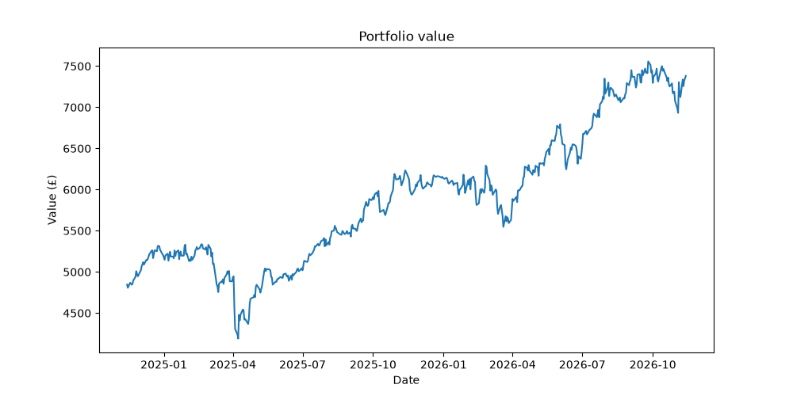
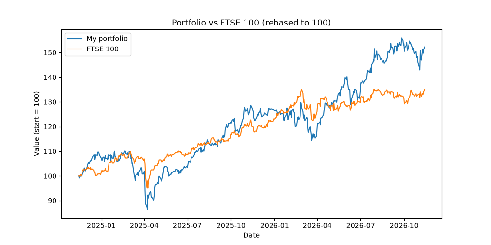
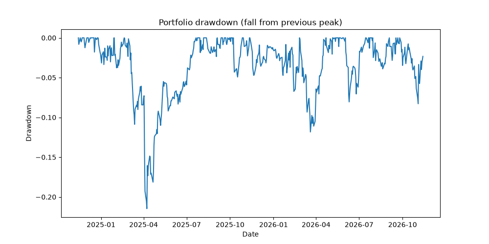

# Portfolio Tracker

A Python tool that downloads two years of real share prices, tracks the daily value of a portfolio in pounds, and measures its returns and risk against the FTSE 100.

## Portfolio

| Holding | Ticker | Shares |
|---|---|---|
| Apple | AAPL | 10 |
| Microsoft | MSFT | 5 |
| HSBC | HSBA.L | 200 |

Values are converted into pounds (HSBC from pence; Apple and Microsoft from US dollars using the GBP/USD exchange rate).

## Results (Nov 2024 – Nov 2026)

| Measure | Result |
|---|---|
| Total return | 52.30% |
| Annualised return | 23.41% |
| Annual volatility | 19.50% |
| Maximum drawdown | -21.47% (8 Apr 2025) |
| FTSE 100 return | 35.08% |
| Outperformance | +17.22 percentage points |

## What it does

- Downloads daily closing prices from Yahoo Finance using yfinance
- Cleans the data (removes weekends, fills holiday gaps) and converts all prices into pounds
- Calculates the portfolio's daily value from shares held × daily prices
- Calculates daily returns, the cumulative total return and the annualised return
- Measures risk using annualised volatility and maximum drawdown
- Charts portfolio value, drawdown, and performance against the FTSE 100 (both rebased to 100)

## Key findings

The portfolio returned 52.3% over two years against 35.1% for the FTSE 100, an outperformance of about 17 percentage points. The trade-off was higher risk: in the April 2025 tariff sell-off it fell about 21% from its peak, more than the FTSE, because of its US tech holdings. One caveat: the share prices are adjusted for dividends but the FTSE 100 index level is not, so the true outperformance is somewhat smaller.

## Setup

    pip install -r requirements.txt
    python tracker.py

## Tools

Python, pandas, yfinance, matplotlib